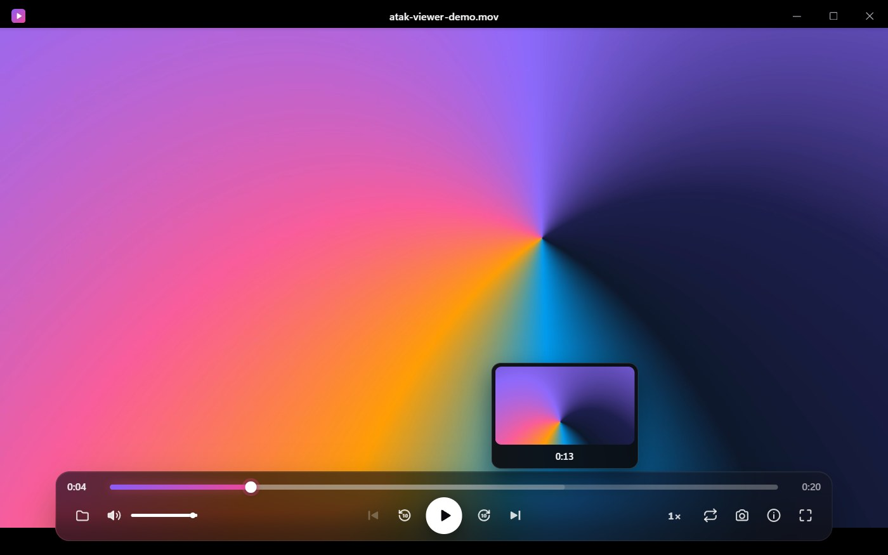
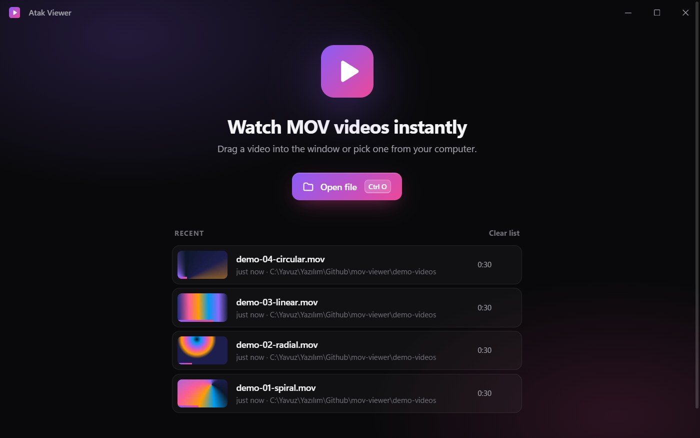
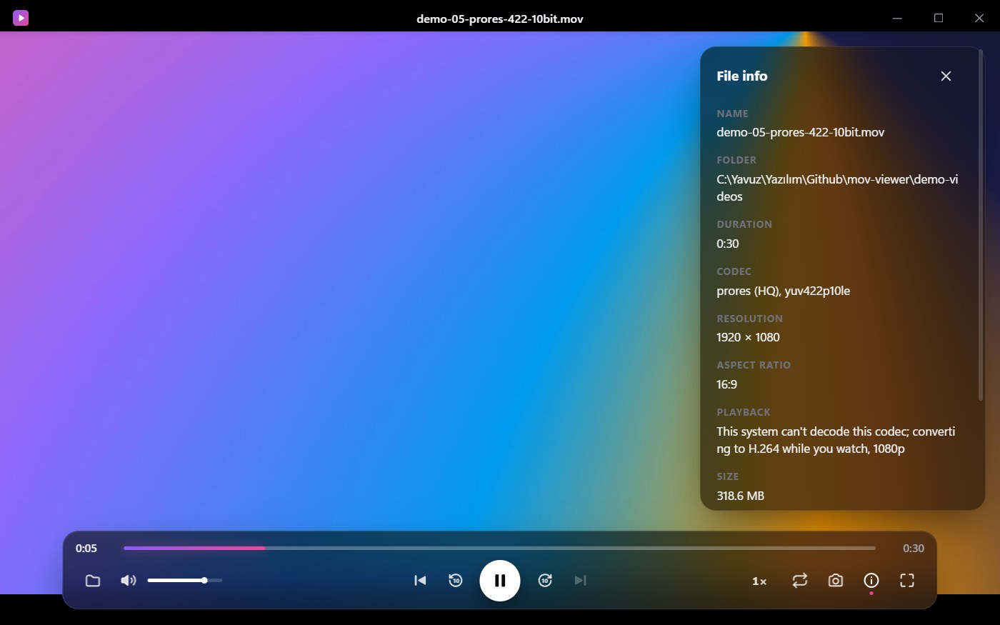
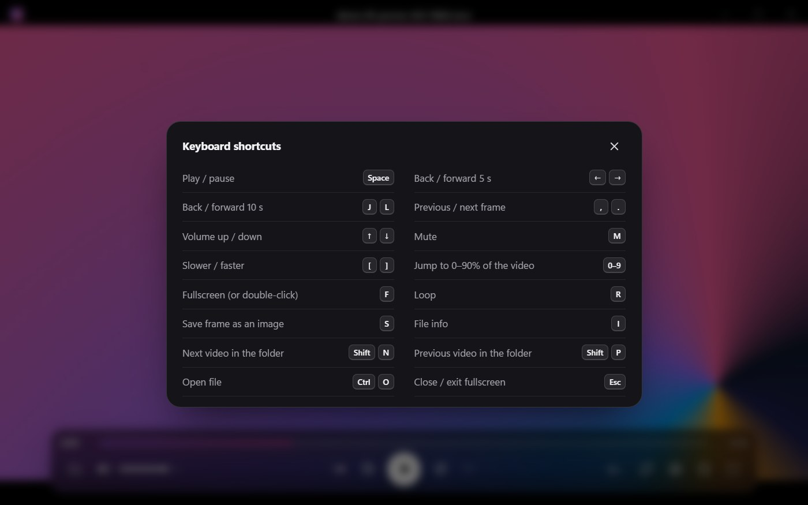

# Atak Viewer: Free MOV Viewer for Windows and Linux

**Atak Viewer** is a free, open-source **MOV viewer** and player for Windows and Linux. Double-click a `.mov` file and
it plays, including the MOV files the built-in players can't open: iPhone HEVC (H.265), 10-bit 4:2:2 footage from
cameras such as Fujifilm, and Apple ProRes.



**[Download for Windows and Linux](https://github.com/yavuzyazici/mov-viewer/releases/latest)** ·
[Türkçe](#türkçe) · Sponsored by [Atak Domain](https://www.atakdomain.com/)

## Features

- **Opens MOV files other players can't.** H.264 plays directly. When the system can't decode the video (HEVC 4:2:2
  10-bit, ProRes) or can't decode it fast enough, the bundled FFmpeg converts it while you watch: playback starts in
  about two seconds instead of after a full conversion, and the progress bar shows how much is ready.
- **Instant re-opens.** A video watched to the end is cached, so it plays directly next time.
- **Resume where you left off**, with a recent-files list that shows a thumbnail of your last frame.
- **Precise playback tools:** frame-by-frame stepping, 0.25×–2× speed, loop, and PNG frame snapshots.
- **Folder playlist:** jump to the previous or next video in the same folder.
- **Keyboard first:** Space, J/K/L, arrow keys, F for fullscreen. Press `?` in the app for the full list.
- **English and Turkish interface**, picked from your system language.
- **Light:** built with Tauri (Rust) instead of Electron; the Windows installer is about 42 MB including FFmpeg.

## Screenshots

| Start screen with recent files | A ProRes MOV converting while it plays |
| --- | --- |
|  |  |



## How to open MOV files on Windows

1. Download the installer from the [Releases page](https://github.com/yavuzyazici/mov-viewer/releases/latest) and run it.
2. Double-click any `.mov` file (the installer associates `.mov` files with Atak Viewer), drag it into the window,
   or press `Ctrl+O`.
3. If Windows can't decode the video, Atak Viewer converts it in the background and starts playing right away.

## How to install on Linux

Download one of the Linux packages from the [Releases page](https://github.com/yavuzyazici/mov-viewer/releases/latest)
(64-bit x86):

- **AppImage**, for any distribution, nothing to install:

  ```bash
  chmod +x atak-viewer_*.AppImage
  ./atak-viewer_*.AppImage
  ```

- **Ubuntu, Debian** (`.deb`):

  ```bash
  sudo apt install ./atak-viewer_*.deb
  ```

- **Fedora, openSUSE** (`.rpm`):

  ```bash
  sudo dnf install ./atak-viewer*.rpm
  ```

The `.deb` and `.rpm` packages register Atak Viewer for `.mov` files, so it appears under "Open with" in your file
manager. On Linux the video engine is GStreamer: the AppImage bundles it, the `.deb` installs the H.264/HEVC decoders
(`gstreamer1.0-libav`) automatically, and on Fedora install `gstreamer1-plugin-openh264` (or `gstreamer1-plugin-libav`
from RPM Fusion).

## Why does my MOV file play only sound, or not at all?

MOV is a container (Apple's QuickTime format); the video inside it can be H.264, HEVC (H.265), ProRes or another
codec. Windows and browser-based players decode HEVC only with the graphics card, and most graphics cards can't
decode the 10-bit 4:2:2 HEVC that recent cameras record. The result is sound with a black screen. Atak Viewer detects
this and decodes the video with FFmpeg instead.

On Linux, GStreamer can decode most of these formats itself, but heavy ones such as 4K 4:2:2 HEVC may play too
slowly. Atak Viewer notices when playback can't keep up and switches to FFmpeg at the same position.

## Supported MOV formats

| Where the file comes from | Video codec inside the .mov | How Atak Viewer plays it |
| --- | --- | --- |
| Most cameras, phones, screen recordings | H.264 | Directly |
| iPhone, iPad | HEVC (H.265), 8 or 10-bit 4:2:0 | Directly when Windows' "HEVC Video Extensions" are installed, otherwise converted while playing |
| Cameras recording 10-bit 4:2:2 (e.g. Fujifilm) | HEVC 4:2:2 10-bit | Converted while playing (up to 1440p) |
| Editing software exports | Apple ProRes | Converted while playing (up to 1440p) |

The table describes Windows. On Linux, GStreamer plays all four directly when its libav plugin is installed, and
Atak Viewer converts whatever doesn't play smoothly. Atak Viewer also opens `.mp4`, `.m4v` and `.webm` files.

## FAQ

**Is Atak Viewer free?**
Yes. It's free and open source under the [MIT license](LICENSE).

**Does it upload my videos anywhere?**
No. Everything runs on your computer, and the original file is never changed.

**Where do converted copies go?**
Into the app's cache folder, capped at 4 GB; the oldest copies are removed first.

**Can it replace QuickTime Player on Windows?**
For watching `.mov` files, yes; it also plays the HEVC and ProRes files QuickTime for Windows never supported.

**Is the interface in English?**
Yes. Atak Viewer is in English, or in Turkish when your system language is Turkish.

**Which Linux distributions does it run on?**
64-bit x86 distributions with WebKitGTK 4.1. The packages are built on Ubuntu 22.04 and tested on Ubuntu 26.04; the
AppImage brings its own libraries and should run on most other distributions.

**Windows shows a SmartScreen warning when I run the installer. Is it safe?**
The installer isn't code-signed yet, so Windows doesn't recognize the publisher. Click **More info → Run anyway**.
The source code is in this repository, and the installer is built from it.

## Build from source

```bash
npm install
npm run fetch-ffmpeg
npm run tauri dev
```

`fetch-ffmpeg` downloads the bundled FFmpeg for the platform it runs on (BtbN LGPL build, pinned version, SHA-256
verified) into `src-tauri/binaries/`, which is not committed. On Linux, first install the
[Tauri prerequisites](https://v2.tauri.app/start/prerequisites/#linux) and GStreamer
(`gstreamer1.0-plugins-good gstreamer1.0-plugins-bad gstreamer1.0-libav`).

Build the Windows installer (`bundle/nsis/`) or the Linux packages (`bundle/appimage/`, `bundle/deb/`, `bundle/rpm/`,
all under `src-tauri/target/release/`) with:

```bash
npm run tauri build
```

Pushing a `v*` tag builds both platforms on GitHub Actions and attaches the packages to a draft release.

FFmpeg is licensed under the LGPL; source code: <https://ffmpeg.org> and <https://github.com/BtbN/FFmpeg-Builds>.

## Sponsor

Atak Viewer is sponsored by [Atak Domain](https://www.atakdomain.com/): domain names, hosting, corporate e-mail and
SSL certificates.

## License

Atak Viewer is released under the [MIT license](LICENSE). The bundled FFmpeg is a separate program under the LGPL.

---

## Türkçe

### Atak Viewer: Windows ve Linux için ücretsiz MOV oynatıcı

**Atak Viewer**, Windows ve Linux için ücretsiz ve açık kaynaklı (MIT lisansı) bir **MOV dosyası açma** ve oynatma
programıdır. `.mov` dosyasına çift tıklayın, video oynasın. Hazır oynatıcıların açamadığı MOV dosyaları da buna dahil:
iPhone HEVC (H.265), Fujifilm gibi kameraların 10-bit 4:2:2 görüntüleri ve Apple ProRes.

**[Windows ve Linux için indir](https://github.com/yavuzyazici/mov-viewer/releases/latest)**

### MOV dosyası nasıl açılır?

1. [Releases sayfasından](https://github.com/yavuzyazici/mov-viewer/releases/latest) kurulum dosyasını indirip
   çalıştırın.
2. `.mov` dosyasına çift tıklayın (kurulum `.mov` dosyalarını Atak Viewer ile ilişkilendirir), pencereye sürükleyin
   ya da `Ctrl+O` ile seçin.
3. Windows videoyu çözemiyorsa Atak Viewer arka planda dönüştürür ve hemen oynatmaya başlar.

### Linux'ta kurulum

[Releases sayfasından](https://github.com/yavuzyazici/mov-viewer/releases/latest) birini indirin: **AppImage**
(kurulum gerektirmez; `chmod +x` ile çalıştırılabilir yapıp açın), Ubuntu/Debian için `.deb`
(`sudo apt install ./atak-viewer_*.deb`) ya da Fedora/openSUSE için `.rpm` (`sudo dnf install ./atak-viewer*.rpm`).

### MOV dosyası neden sadece ses veriyor?

MOV bir kapsayıcıdır (Apple QuickTime biçimi); içindeki görüntü H.264, HEVC (H.265), ProRes ya da başka bir kodek
olabilir. Windows ve tarayıcı tabanlı oynatıcılar HEVC'yi yalnızca ekran kartıyla çözer; ekran kartlarının çoğu da
yeni kameraların kaydettiği 10-bit 4:2:2 HEVC'yi çözemez. Sonuç: ses gelir, ekran siyah kalır. Atak Viewer bunu
fark eder ve görüntüyü FFmpeg ile çözer.

### Özellikler

- Windows'un oynatamadığı MOV dosyalarını izlerken dönüştürür; oynatma yaklaşık iki saniyede başlar.
- Sonuna kadar izlenen video önbelleğe alınır, sonraki açılışta doğrudan oynar.
- Kaldığınız yerden devam, son karenin küçük resmiyle son açılanlar listesi.
- Kare kare ilerleme, 0,25×–2× hız, döngü ve kareyi PNG olarak kaydetme.
- Klasördeki önceki / sonraki video; uygulamada `?` ile tüm klavye kısayolları.
- Türkçe ve İngilizce arayüz, sistem diline göre seçilir.

Kurulum dosyası henüz kod imzalı olmadığından Windows SmartScreen uyarı gösterebilir: **Ek bilgi → Yine de çalıştır**.

### Sponsor

Atak Viewer, [Atak Domain](https://www.atakdomain.com/) sponsorluğunda geliştirilmektedir.
